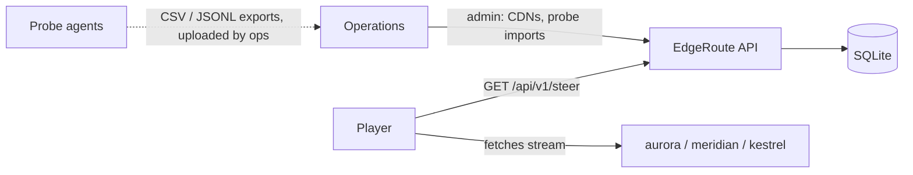

# Architecture (current state)

EdgeRoute is a single FastAPI service with a SQLite database, accessed through the SQLAlchemy
ORM, with the schema managed by Alembic migrations (ADR 0002).

## Modules

| Module | Responsibility |
|---|---|
| `app/main.py` | Application factory, router wiring, `/healthz` |
| `app/config.py` | Settings from environment variables |
| `app/db.py` | SQLAlchemy engine, per-request sessions, running migrations |
| `migrations/` | Alembic migrations: every schema change, in order |
| `app/auth.py` | Admin token check for write endpoints |
| `app/cdns/` | CRUD for CDN providers (name, base URL, weight, enabled, cost) |
| `app/steering/` | Picks a CDN for a viewer by weighted random choice |
| `app/probes/` | Imports probe exports, computes health statistics per CDN and region |

Each feature folder follows the same layout: `router.py` (HTTP endpoints), `schemas.py` (the API
contract, pydantic), `models.py` (database tables, SQLAlchemy), and `repository.py` or
`service.py` (database access and logic).

## Data model

- `cdn` (`app/cdns/models.py`): one row per provider. `weight` is its share of traffic relative to
  the others.
- `probe` (`app/probes/models.py`): one row per probe measurement (time, provider, region, status,
  TTFB in ms).

## Known gaps

- Steering ignores probe health and the viewer's region (NWM-103).
- Probe ingestion is incomplete (NWM-102).
- No release process or production container setup yet (NWM-104).
- No user interface: operations use curl or the Swagger page at `/docs` (NWM-107).
